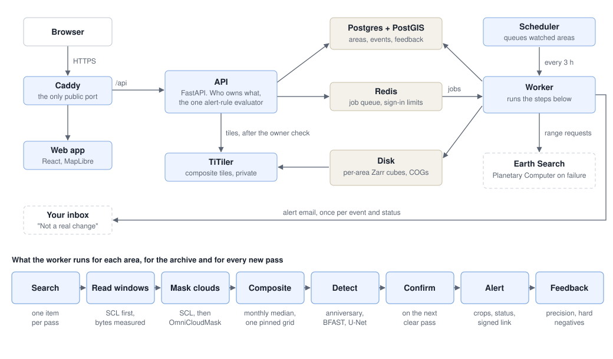

# Orbit Diff

Watch places for change from orbit. Draw a polygon around an area you care about, browse
about ten years of Sentinel-2 imagery over it as cloud-free monthly composites, see what
changed (new buildings and roads, forest loss, solar farms, water), and get an email when
a new satellite pass shows a change.

A change map is easy to make. The point of this project is an alert you can trust: one
that survives clouds, haze, seasons and sensor quirks before it reaches your inbox.

## Why it's hard

Most things that look like change aren't:

- **Clouds, haze and shadows**, including thin cirrus the scene classification misses.
- **Seasons and crop cycles.** July against January finds winter, not change.
- **Snow and floods**: real, but transient.
- **Processing changes.** Processing baseline 04.00 (Jan 2022) added a −1000 offset to
  the pixel values, and catalog metadata about it is not always right (see below).
- **Misregistration.** Passes shift by up to about a pixel; roof and road edges flicker.

So an event alerts only if it shows in clear pixels of real observations on both sides,
falls outside the seasonal envelope, is larger than a minimum mapping unit, and is
confirmed by a later clear pass. One scene is a suspicion. Gap-filled pixels are for
display only and never count as evidence.

## How it works



1. **Search.** [Earth Search](https://earth-search.aws.element84.com/v1) (`sentinel-2-l2a`,
   COGs on AWS) is the primary catalog, with Microsoft Planetary Computer as the fallback.
   Exactly one item is kept per pass: the newest processing baseline, and the tile in the
   AOI's own UTM zone.
2. **Read only what's needed.** Only the AOI's window is read, via HTTP range requests.
   The 20 m scene classification (SCL) is read first, at about 1/50 of a pass's bytes, and
   the 10 m bands only for passes with clear pixels over the AOI. Each AOI's passes are
   cached once in a Zarr cube, so changing a mask or threshold never refetches imagery.
   Bytes read are measured from the COG blocks each window touches and shown to the user.
   On a 75-pass test run that was 248 MB, against 19.5 GB for the same files whole.
3. **Harmonize.** One function turns digital numbers into surface reflectance for every
   catalog, from the processing baseline and the catalog's offset flag. A per-pass pixel
   check backs the flag: Earth Search marks some 2022 items wrongly, and following the
   flag would subtract the offset twice. Such passes are kept out of every composite.
4. **Mask.** SCL drops no data, defective pixels, cloud shadow, cloud and cirrus; snow is
   kept and flagged. [OmniCloudMask](https://github.com/DPIRD-DMA/OmniCloudMask) runs on
   top for the haze and thin cloud SCL misses. Both are dilated, because cloud edges are
   where masks fail.
5. **Composite.** A per-pixel median of clear observations per month, written as
   Cloud-Optimized GeoTIFFs on a pinned grid in the AOI's UTM zone. Display copies fill
   empty pixels from the nearest clear months and flag them. One code path serves both the
   archive backfill and pass-by-pass updates; a test checks the two give byte-identical
   files.
6. **Detect.** A naive NDVI-drop baseline, change vector analysis on anniversary
   composites, and a BFAST-style season-and-trend fit per pixel; production runs all three
   with the rules below. A Siamese U-Net for buildings joins them once it passes the gate
   on the evaluation set. Every detector is reported against the baseline, by category and
   by hard case (cropland, floodplain, snow).
7. **Confirm.** A change must show in a single clear pass, not only in a monthly median.
   It starts `pending`; the next clear pass over its footprint makes it `confirmed` or
   `dismissed`. It is `seasonal` (labelled, never deleted) if snow covers it, if the place
   looked like this in the same month of an earlier year (floods, crop rotations), or if
   it reverts within three months. Every event records the passes, months, method version
   and thresholds it came from.
8. **Alert.** Each area has a rule: on or off, the categories to hear about, whether to skip
   seasonal changes, and the smallest change (0.1 to 5 ha). One evaluator in the API
   decides; the web app's preview asks it how many past changes would have emailed you,
   false alarms a later pass took back included. Turning alerts on starts from the newest
   pass already in the archive, so its history never arrives as a pile of emails. A
   scheduler queues an update for every watched area every few hours. A change alerts
   once, with outlined before/after crops, size, NDVI, how much of it changed on the passes
   that decided it, status and method, then at most once more when it's confirmed,
   dismissed or found seasonal. Each email is claimed in the database before it's sent, so
   a retried job never sends it twice. Many changes at once arrive as a digest.
9. **Feedback.** "Not a real change", from the email (a signed link that needs no sign-in)
   or the app, is stored with the change's full provenance. It is the precision signal and
   training data, and it only measures precision: people only see what alerted.
10. **Monitor.** An admin page shows alert precision from that feedback per method and
    category, flagging any that fall too low for a person to review (nothing changes on
    its own), the latest evaluation-set scores, and pipeline health: runs and failures,
    passes read and left to retry, catalog errors and fallback, bytes read, emails sent or
    failed, and time from pass to alert. When the building model's precision is flagged,
    the feedback trains a retraining candidate. It is only registered: replacing the
    champion is a person's decision, through the gate.

## Results

**There is no benchmark table yet.** The evaluation set's labels have to be checked against
high-resolution imagery first, and numbers from unverified labels would measure nothing.
`orbitdiff evaluate` prints the table, per method, category and hard case, once they are.

The building model on OSCD's official test cities, scored per pixel: F1 0.392 (precision
0.481, recall 0.332), from 0.05 on Valencia to 0.73 on Montpellier.

## Why it doesn't cry wolf

Over ten years of an 8.5 km² area around Grünheide, where the Tesla factory went up, the
detectors found 1,604 candidate changes. The rules kept 232:

| What happened to it | Changes |
|---|---|
| **Confirmed** by a later clear pass | 232 |
| **Seasonal**: snow, a look the place has had before in that month, or it reverted | 1,225 |
| **Dismissed**: the next clear pass didn't show it | 147 |

Each rule answers one way of being wrong:

- **Masking** removes cloud, shadow and cirrus from SCL, then haze and thin cloud with a
  learned model, both dilated because cloud edges are where masks fail.
- **Anniversary comparison** compares a month with the same month a year earlier, so winter
  isn't a change. A BFAST-style seasonal model covers trends the anniversary misses.
- **Minimum mapping unit** drops one- and two-pixel slivers along roads and roofs, where
  misregistration lives. Below it, nothing can alert.
- **Confirmation** treats one pass as a suspicion. Only the next clear pass over the footprint
  can make it `confirmed`, and a false alert costs more than a late one.
- **Real observations only.** Gap-filled months exist for the timelapse and are never evidence.

Whether the 232 are right is what the evaluation set will say.

## Read only what you need

That same area's archive is 1,406 passes. Reading it cost **3.4 GB** of the 324 GB those files
hold, about 1%. SCL comes first, at about 1/50 of a pass's bytes: 486 passes stopped at the
tile's cloud-cover pre-filter, 315 at SCL, and only 605 needed their 10 m bands. Each block
read is counted, and the total is shown to the user next to the area.

The window stack is cached per area, so changing a mask or a threshold costs no bytes.

## Trained on L1C, served on L2A

OSCD, the training set, is top-of-atmosphere. The product reads surface reflectance. Raw
values are far apart (blue on Chongqing: 0.125 against 0.073), so each image is standardised
per band before the model sees it.

One OSCD test city has both dates in the L2A archive, so the gap could be measured directly,
on the same pixels:

| Chongqing | F1 | Precision | Recall |
|---|---|---|---|
| L1C (trained on) | 0.246 | 0.705 | 0.149 |
| L2A (served on) | 0.252 | 0.696 | 0.154 |

The two runs agree on 99.59% of pixels. It's one city, and a city like the training data, so
how the model behaves on forest and farmland is still the evaluation set's question. Details
in [`docs/spikes.md`](docs/spikes.md), section 6.

## Status

| Phase | State |
|---|---|
| 0. Setup and spikes (coverage, offset, read cost, fallback) | done |
| 1. Scene search and windowed reads into a per-AOI cube | done |
| 2. Cloud masking: SCL plus OmniCloudMask | done |
| 3. Monthly median composites as COGs | done |
| 4. API, background backfills, map tiles | done |
| 5. Web app: draw an AOI, browse the archive | done |
| 6. Evaluation harness and naive baseline (labels still to verify) | done |
| 7. Classical detectors, events and statuses (thresholds provisional) | done |
| 8. U-Net for buildings (promotion waits for verified labels) | in progress |
| 9. Accounts, alert rules, alert emails, feedback | done |
| 10. Monitoring, and retraining candidates from feedback | done |
| 11. Docker Compose stack; production stack, releases and backups (built and run locally, not deployed yet) | in progress |
| 12. Documentation (the benchmark waits for verified labels) | in progress |

`mockup/orbit-diff.html` is an early sketch of the UI (synthetic imagery and events), not its final design.

## Stack

- **Pipeline:** Python 3.12, rasterio, xarray, Zarr, SciPy, pystac-client, shapely, pyproj;
  OmniCloudMask and MLflow in a separate `ml` dependency group.
- **Backend:** FastAPI, Postgres + PostGIS (SQLAlchemy, GeoAlchemy2, Alembic), RQ on
  Redis for backfill jobs, TiTiler for composite map tiles.
- **Web app:** Vite, React and TypeScript, MapLibre with Terra Draw, an OpenFreeMap
  basemap; Biome, Vitest, pnpm.
- **Tooling:** uv, ruff, pytest, pre-commit, GitHub Actions.

## Deploying

[`docs/deploy.md`](docs/deploy.md): one machine behind Caddy, with what you need to provide,
updates, backups and how to restore them.

## Running it locally

No API keys are needed: Earth Search is open, and Planetary Computer issues an anonymous
token. The one secret is a signing key for the links in alert emails, which you generate
yourself:

```bash
cp .env.example .env               # then set ORBITDIFF_SIGNING_KEY (see the comment there)
```

### The whole stack in Docker

```bash
docker compose up --build          # http://localhost:8080
```

That brings up Postgres+PostGIS, Redis, Mailpit, TiTiler, the API (8000), a worker, the
scheduler and the web app, and migrates the database first. The worker image carries
PyTorch for the cloud model, so its first build takes a while. Cubes, composites and the
model live in `./data`, shared with the development setup below.

### For development

Requires [uv](https://docs.astral.sh/uv/), Node 22.12+ and pnpm. Start only the
infrastructure in Docker:

```bash
uv sync --group ml                 # ml: the cloud model, needed by mask and worker
docker compose up -d db redis mailpit titiler   # Postgres (5433), Redis, Mailpit, TiTiler (8001)
uv run alembic upgrade head
```

Run the API, a worker for backfills, and the web app:

```bash
uv run uvicorn orbitdiff.api:app   # http://localhost:8000/docs
uv run orbitdiff worker            # runs queued backfills, then sends due alert emails
cd web && pnpm install && pnpm dev # http://localhost:5173
```

Sign in with any address: the sign-in link, like every email in development, lands in
Mailpit at http://localhost:8025 and nowhere else. Draw an area, watch its backfill, then
step through the archive with A/B swipe, NDVI and single passes, look through the changes
found, and turn on alerts. `web/.env.example` lists the API and basemap URLs it reads.

For alerts on new passes, run the scheduler too. It queues an update for every area with
alerts on, every `[schedule] poll_every_hours`:

```bash
uv run orbitdiff scheduler         # --once polls once and exits
```

The admin page (`#/admin`) is for the addresses in `ORBITDIFF_ADMIN_EMAILS`.

Areas drawn before accounts existed have no owner and show for no one until you give them
one: `uv run orbitdiff assign-aois --email you@example.com`.

Or step by step from the command line, with no database:

```bash
uv run orbitdiff fetch --aoi examples/aoi_kyiv.geojson --start 2021-06-01 --end 2021-09-30
uv run orbitdiff mask --id aoi_kyiv
uv run orbitdiff composites --id aoi_kyiv
uv run orbitdiff mask-report --id aoi_kyiv   # contact sheet: SCL alone vs SCL + model
```

Everything lands in `data/` (cubes, masks, composites, STAC cache), which is never
committed. AOIs are capped at 10 km².

## What I'd do with more time

- **Radar.** Sentinel-1 sees through cloud, so a confirmation wouldn't have to wait for a clear
  optical pass. In a cloudy winter, that wait is the biggest part of an alert's delay.
- **Larger areas.** Everything assumes areas under 10 km²: the windowed reads, the per-area
  cube, a single worker. Going past that means tiling and object storage (ADR-014).
- **A model that says what changed.** Today a category comes from rules on the spectral
  change. A classifier trained on confirmed events would be more useful, once there are
  enough of them.

## Configuration

- **`config/pipeline.toml`**: every pipeline parameter (catalogs and asset keys, AOI
  size cap, archive start, SCL classes, dilation, cloud model version, offset check,
  gap-fill distance, minimum mapping unit). No thresholds live in code.
- **Environment** (`ORBITDIFF_*`, see `.env.example`): paths, database and Redis URLs,
  the email server (Mailpit in development), the URLs links in emails point to, the
  signing key and the admins' addresses. `.env` is never committed.

## Tests

```bash
uv run pytest
cd web && pnpm check && pnpm test   # Biome, Vitest
```

Detection methods are scored on the evaluation set in `eval/`, which needs labelled,
verified areas. Admins label them in the app (see `eval/README.md`):

```bash
uv run orbitdiff evaluate --method naive --fetch
```

It also prints a cross-check of `vegetation_loss` events against Hansen Global Forest Change
loss years, which is a second opinion and not a score ([attribution](#data-and-attribution)).

The building model (a Siamese U-Net) trains on OSCD, on CPU, and is registered in MLflow.
It runs in production only once `promote` has checked it on the evaluation set: it must
not raise false alerts, not lose recall, and beat the naive baseline. Without a verified
evaluation set, `promote` refuses.

```bash
uv run --group ml orbitdiff train-buildings          # downloads OSCD (513 MB) once, into data/
uv run --group ml orbitdiff train-buildings --feedback   # with "Not a real change" as negatives
uv run --group ml orbitdiff evaluate --model-version 1
uv run --group ml orbitdiff promote --version 1      # then restart the worker
```

Tests run offline. Rasters are small synthetic GeoTIFFs with staged changes, and sockets
reach only localhost. The API tests need Postgres: set `ORBITDIFF_TEST_DATABASE_URL` to a
database on the compose Postgres, otherwise they are skipped. CI runs everything against a
PostGIS service.

## Repository

```
src/orbitdiff/   pipeline, API and jobs
web/             the web app
tests/           unit and end-to-end tests
config/          pipeline.toml
eval/            the evaluation set: labelled areas, in git
migrations/      Alembic migrations
spikes/          scripts behind the findings in docs/spikes.md
docs/            implementation plan, ADRs, spike results, deploy runbook
deploy/          production compose file, Caddy, backups, updates
mockup/          an early UI sketch
docker/          TiTiler colormap, backup image
examples/        a sample AOI
```

## Data and attribution

**Hansen Global Forest Change** is used for one thing: a cross-check in `orbitdiff evaluate`,
which compares `vegetation_loss` events with its loss years. It never touches detection, alerts
or model promotion, and it isn't ground truth. It's another model's annual map, with errors of
its own and a lag after each year ends, so it sits next to the labelled evaluation and doesn't
replace it.

- **Credit:** Source: Hansen/UMD/Google/USGS/NASA.
- **Citation:** Hansen, M. C., P. V. Potapov, R. Moore, M. Hancher, S. A. Turubanova,
  A. Tyukavina, D. Thau, S. V. Stehman, S. J. Goetz, T. R. Loveland, A. Kommareddy, A. Egorov,
  L. Chini, C. O. Justice, and J. R. G. Townshend. 2013. "High-Resolution Global Maps of
  21st-Century Forest Cover Change." *Science* 342 (15 November): 850–53. Data available on-line
  from: <https://glad.earthengine.app/view/global-forest-change>.
- **Licence:** [CC BY 4.0](https://creativecommons.org/licenses/by/4.0/). The version is pinned
  in `config/pipeline.toml`.
- **Changes made:** windows of the `lossyear` and `treecover2000` layers are resampled onto each
  area's 10 m UTM grid by nearest neighbour, and loss counts only where canopy in 2000 is at
  least `min_treecover` percent. Nothing from GFC is redistributed here.

## Further reading

- [`docs/implementation_plan.md`](docs/implementation_plan.md): direction and phases, with
  as-built notes.
- [`docs/ADR.md`](docs/ADR.md): decisions and why they changed.
- [`docs/spikes.md`](docs/spikes.md): the measurements behind them: archive coverage,
  the offset in metadata versus pixels, read cost, catalog fallback.
- [`CLAUDE.md`](CLAUDE.md): working rules for this repository.
